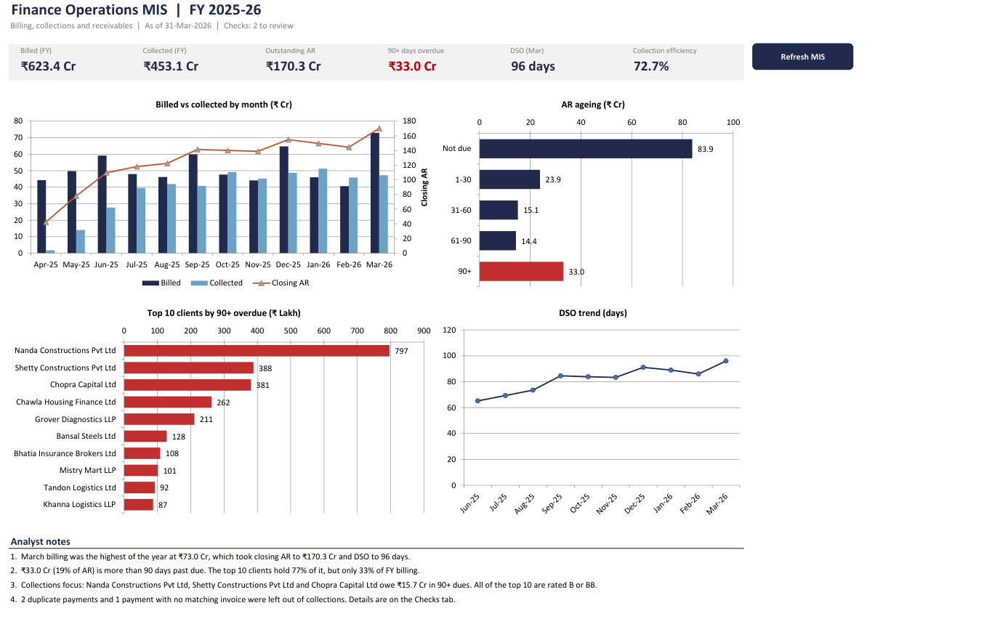
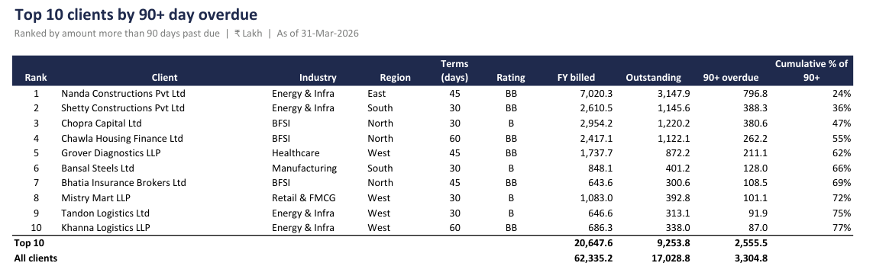
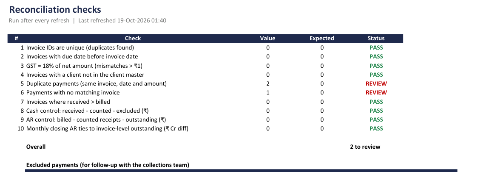

# Finance Operations MIS: Billing, Collections and Receivables

An Excel-based MIS that tracks billing, collections, receivables ageing and DSO for a professional services firm across FY 2025-26, plus a short leadership deck built from it.

I built this to practise the kind of recurring finance reporting that most operations teams still run in Excel: pull the month's billing and receipts, reconcile them, age what is still open, and turn it into something a leadership team can read in five minutes.



## What's in the workbook

`Finance_Ops_MIS_FY26.xlsm` has nine sheets:

| Sheet | What it does |
|---|---|
| Dashboard | Six KPIs, four charts and analyst notes that update with the data |
| Monthly | Billed, collected, opening/closing AR, collection efficiency and DSO by month |
| Ageing | Outstanding AR in 0-30 / 31-60 / 61-90 / 90+ day buckets, split by service line, region and industry |
| Clients | Top 10 clients by 90+ day overdue, with cumulative share |
| Checks | 10 reconciliation checks with PASS / REVIEW status and a list of excluded payments |
| Invoices, Payments, ClientMaster | Raw data loaded through Power Query, with calculated columns added on top |
| Settings | As-of date, refresh time and notes |

How the data flows:

1. **Power Query** loads the three CSV files from `data/` and sets the column types.
2. **Calculated columns** on the tables work out what has been received against each invoice, what is still outstanding, days past due and the ageing bucket. Payments that are duplicates or don't match an invoice are flagged and left out of collections.
3. **Summary sheets** use SUMIFS, COUNTIFS, INDEX/MATCH and RANK on those tables, so nothing is hard-coded.
4. **The `RefreshMIS` macro** (`vba/modRefresh.bas`) points the queries at the `data` folder next to the workbook, refreshes the tables in the right order, recalculates and reports the reconciliation result. `ExportDashboardPDF` saves the dashboard as a PDF for circulation.

## Key findings (as of 31 March 2026)

- ₹623.4 Cr was billed and ₹453.1 Cr collected in the year, leaving **₹170.3 Cr in receivables**.
- DSO rose from 65 days in June to **96 days in March**. A March billing peak of ₹73.0 Cr added ₹25.7 Cr to AR in one month.
- **₹33.0 Cr (19% of AR) is more than 90 days past due.**
- **Ten clients hold 77% of the 90+ overdue** but only 33% of the year's billing. All ten are rated B or BB.
- Energy & Infra clients account for ₹15.2 Cr of the 90+ bucket on their own.
- The checks caught two duplicate receipts and one payment posted against an invoice that doesn't exist. All three are excluded from collections and listed on the Checks sheet.



The leadership deck (`deck/Receivables_Review_FY26.pptx`, PDF copy alongside) covers these findings in five slides and ends with a Q1 action plan.

## Reconciliation checks



Two of the checks are control totals: billed minus receipts minus outstanding should be zero, and the closing AR on the Monthly sheet should tie back to the invoice-level outstanding. If either one breaks after a refresh, something in the data or the formulas has changed and the numbers shouldn't go out.

## Data

Real client billing data can't be published, so `scripts/generate_data.py` builds a realistic stand-in. It produces 160 clients, 11,400 invoices and about 9,200 payments, with:

- a heavy-tailed client base (a few large accounts, many small ones)
- quarter-end and March billing peaks
- 30/45/60 day payment terms, with a group of habitually late payers that skews towards bigger clients
- partial payments, invoices still open at year end, and a few deliberate data errors for the checks to find

The script uses a fixed seed, so it produces the same files every time.

## How to run it

1. Clone or download the repo and keep the folder structure as it is.
2. Open `Finance_Ops_MIS_FY26.xlsm` and enable macros.
3. Click **Refresh MIS** on the Dashboard. The data is already loaded, so this step only matters if you change the CSVs or move the folder.

To regenerate the data:

```
pip install -r requirements.txt
python scripts/generate_data.py
```

Then open the workbook and click Refresh MIS.

If the macro isn't in the workbook (for example after downloading the file without it), import it with Alt+F11 > File > Import File > `vba/modRefresh.bas`.

## Repository layout

```
finance-ops-mis/
├── Finance_Ops_MIS_FY26.xlsm   workbook
├── data/                       clients, invoices and payments CSVs
├── scripts/generate_data.py    builds the sample data
├── vba/modRefresh.bas          refresh and PDF export macros
├── deck/                       leadership deck (PPTX and PDF)
└── docs/                       screenshots used in this README
```

## Tools

MS Excel (Power Query, structured tables, SUMIFS/COUNTIFS, INDEX/MATCH, conditional formatting, charts), VBA, PowerPoint, Python (pandas, NumPy).
